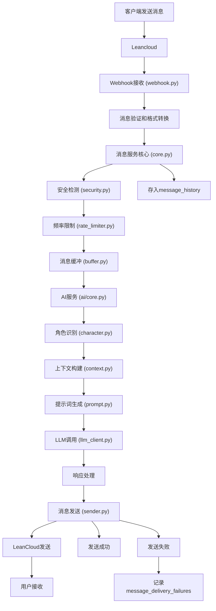

# 消息流程设计

## 消息结构设计

### MVP阶段消息结构（LeanCloud传输格式）

```json
{
  "msg_id": "client_1710001111222_abc123",  // 消息ID（客户端生成或服务端生成）
  "from": "qiao_user001",                   // 发送者qiao_id
  "to": "qiao_xm001",                       // 接收者qiao_id
  "conv_id": "conv_xyz789",                 // 对话ID（后端管理）
  "content": "你好",                         // 消息内容
  "message_type": 1,                        // 消息类型：1=TEXT, 2=TYPING_START, 3=TYPING_END, 4=CHAT_INFO, 9=NOTIFICATION
  "supports_typing": true,                  // 客户端是否支持输入状态
  "sent_time": 1710001111222                // 发送时间戳（毫秒）
}
```

### 消息ID设计

**单一ID字段设计：**

消息使用单一的`msg_id`字段，通过消息方向判断ID类型：

1. **用户发送的消息**
   - `msg_id`由客户端生成
   - 格式：`client_{timestamp}_{random}`
   - 示例：`client_1710001111222_abc123`
   - 用途：客户端消息去重、状态追踪、失败重试

2. **AI/系统发送的消息**
   - `msg_id`由服务端生成（Snowflake ID）
   - 格式：数字ID
   - 示例：`223788765171154945`
   - 用途：服务端消息管理和查询

3. **转发消息**
   - 保持原始`msg_id`不变
   - 用户A → 服务端 → 用户B，`msg_id`始终是用户A生成的客户端ID
   - 服务端只生成`msg_id_server`用于数据库存储

**数据库存储：**

message_history表存储两个ID：

- `msg_id_server`：服务端统一生成的Snowflake ID（主键）
- `msg_id_client`：客户端生成的ID（仅用户消息有值）

**消息ID使用场景：**

- **客户端发送消息**：生成`msg_id`（客户端ID），发送到LeanCloud
- **服务端接收消息**：生成`msg_id_server`，存储到数据库，保持`msg_id`不变
- **服务端发送消息**：生成`msg_id`（服务端ID），发送到LeanCloud
- **消息发送失败**：通过`msg_id`标识失败的消息
- **消息重试**：使用`msg_id`避免重复发送

### supports_typing字段说明

- `true`: 客户端支持输入状态（小程序）
  - 会发送TYPING_START和TYPING_END消息
  - 服务端使用智能缓冲策略
- `false`或不存在: 客户端不支持输入状态（公众号等）
  - 不会发送输入状态消息
  - 服务端使用NO_TYPING_WAIT策略

## 消息处理流程

客户端与服务端之间通信使用统一的Leancloud系统对话。



## 详细流程设计

### 1. 消息接收阶段 (services/message/providers/leancloud/webhook.py)

处理步骤：

- 验证Webhook签名
- 解析LeanCloud消息格式
- 转换为内部消息格式
- 调用消息服务核心处理

### 2. 消息处理阶段 (services/message/core.py)

处理步骤：

- 安全检测: 检查消息内容是否违规
- 频率限制: 防止用户刷屏，限制发送频率
- 消息缓冲: 短时间内多条消息合并处理
- 消息加密: 敏感内容加密存储

### 3. 消息缓冲机制 (services/message/buffer.py)

#### 设计理念

类似于人会等待对方说完整件事然后再回复，系统通过智能缓冲策略合并短时间内的多条消息。

#### 缓冲配置（存储在system_configs表）

```python
# 配置项
MESSAGE_BUFFER_NORMAL_WAIT = 3000      # 普通等待：3秒
MESSAGE_BUFFER_TYPING_WAIT = 10000     # 长等待（输入中）：10秒
MESSAGE_BUFFER_TYPING_END_WAIT = 1000  # 短等待（输入结束）：1秒
MESSAGE_BUFFER_NO_TYPING_WAIT = 2000   # 无输入状态等待：2秒
```

#### 缓冲策略逻辑

**1. 客户端不支持输入状态（supports_typing=false或不存在）**

- 使用NO_TYPING_WAIT（2秒）
- 适用于公众号等无法检测输入状态的客户端

**2. 客户端支持输入状态（supports_typing=true）**

根据消息类型使用不同等待时间：

- **TEXT消息**: NORMAL_WAIT（3秒）
  - 用户发送文本消息后等待3秒
  - 如果3秒内有新消息，重置定时器
  - 3秒后开始处理所有缓冲的消息

- **TYPING_START消息**: TYPING_WAIT（10秒）
  - 用户开始输入，进入长等待
  - 给用户充足时间完成输入
  - 10秒内如果收到新消息，重置定时器

- **TYPING_END消息**: TYPING_END_WAIT（1秒）
  - 用户结束输入，进入短等待
  - 快速响应用户
  - 1秒后开始处理

#### 核心设计决策

**1. 使用 ai_contexts 表管理缓冲状态**

- 消息到达时立即存入 `ai_contexts` 表
- 利用 `reply_status` 字段管理状态：
  - `PENDING (1)` - 等待处理
  - `PROCESSING (2)` - 处理中
  - `DONE (3)` - 已完成
- 利用 `context_metadata` 字段存储缓冲元数据

**2. 消息合并策略**

查询最新一条 context：

- 如果 `role = USER` → 合并到该条记录（追加内容）
- 如果 `role = ASSISTANT` → 创建新的 USER 记录（带时间戳）

**3. 时间戳策略**

- **第一条消息**：增加时间戳 `[2025-01-18 10:30:15] 消息内容`
- **后续消息**（单次等待中）：不增加时间戳，直接追加
- **新一轮等待**：增加新时间戳

示例：

```
[2025-01-18 10:30:15] 你好
我想问一下
今天天气怎么样

[2025-01-18 10:30:25] 还有一个问题
```

**4. 服务重启处理**

- 消息已存储在数据库，不会丢失
- 定时器丢失，但下次消息到达时自动恢复
- 不需要启动恢复逻辑

**5. 函数式编程**

- 使用纯函数，不使用类
- 状态存储在数据库，不在内存
- 符合项目的函数式编程风格

### 4. 输入状态处理机制

**说明：** 输入状态的客户端实现逻辑请参考 `docs/prototype/minipg.md` 文档。

**服务端处理：**

服务端不发送TYPING_END消息，客户端通过以下方式自动隐藏输入状态：

- 收到TEXT消息时立即隐藏
- 30秒超时自动隐藏
- 用户发送消息时立即隐藏

### 5. 对话提示信息处理机制（message_type=4）

#### 5.1 对话提示信息类型

对话提示信息用于在聊天界面向用户展示状态信息，不需要AI处理。

**消息类型：**

```python
class ChatInfoType(IntEnum):
    CONTACT_ADDED = 1        # 对方已将你添加为联系人
    MESSAGE_BLOCKED = 2      # 消息已发出，但对方拒收了
    NOT_FRIEND = 3           # 对方还没有添加你为联系人
```

#### 5.2 消息结构

**不带 action 的消息**：

```json
{
  "msg_id": "223788765171154945",
  "from": "system",
  "to": "qiao_user_001",
  "message_type": 4,
  "content": "对方已将你添加为联系人",
  "sent_time": 1710001112000
}
```

**带 action 的消息**：

```json
{
  "msg_id": "223788765171154946",
  "from": "system",
  "to": "qiao_user_001",
  "message_type": 4,
  "content": "消息已发出，但对方拒收了",
  "action": {
    "type": "mark_message_failed",
    "target_msg_id": "client_1710001111222_abc123"
  },
  "sent_time": 1710001113000
}
```

**action 字段说明**：

- `type`: 操作类型（mark_message_failed）
- `target_msg_id`: 目标消息ID（客户端生成的消息ID）

**action 类型枚举**：

```python
class ChatInfoActionType(str, Enum):
    MARK_MESSAGE_FAILED = "mark_message_failed"  # 标记消息为失败
```

#### 5.3 架构设计

**架构分层：**

对话提示信息的发送采用三层函数架构：

```
业务层 (Business Layer)
  ↓ 调用: send_chat_info(to_qiao_id, conv_id, content)
  ↓ 业务层负责: 从CHAT_INFO_TEMPLATES获取文本
消息服务层 (Message Service)
  ↓ 调用: send_message(from_qiao_id="system", to_qiao_id, conv_id, content, message_type=CHAT_INFO)
  ↓ 调用: _send_message_internal(...)
Provider层 (LeanCloud)
  ↓ 调用: provider.send_message_as_system(to_qiao_id, conv_id, content)
  ↓ 处理: from="system"等协议字段
LeanCloud REST API
```

**Content字段设计：**

对话提示信息的content字段直接存储最终显示文本：

1. **使用预定义模板：**
   - 业务层从CHAT_INFO_TEMPLATES获取文本
   - 调用send_chat_info()传入文本
   - 文本存入content字段
   - 客户端直接显示content字段

示例代码：

```python
from enums.templates import CHAT_INFO_TEMPLATES, ChatInfoType

content = CHAT_INFO_TEMPLATES[ChatInfoType.CONTACT_ADDED]
await send_chat_info(
    db=db,
    to_qiao_id=user_qiao_id,
    conv_id=conv_id,
    content=content,
)
```

#### 5.4 发送场景

1. CONTACT_ADDED - 对方已将你添加为联系人

当用户成功添加联系人后，系统自动发送此消息。

2. MESSAGE_BLOCKED - 消息已发出，但对方拒收了

当用户发送的消息被对方屏蔽时，系统自动发送此消息。

3. NOT_FRIEND - 对方还没有添加你为联系人

当用户向未添加自己为联系人的对方发送消息时，系统自动发送此消息。

#### 5.5 显示规则

客户端处理：

1. 聊天窗口内显示
   - 居中显示
   - 灰色文字
   - 小字体
   - 不显示头像
   - 不显示时间（可选）

2. 聊天列表显示
   - 最后一条消息显示对话提示信息内容
   - 灰色文字
   - 不计入未读数

#### 5.6 存储规则

- 存储到message_history表
- from_type = 4 (system)
- from_id = 0
- from_qiao_id = "system"
- message_type = 4 (CHAT_INFO)
- content字段包含完整文本

### 6. Block功能和消息拒收处理

#### 6.1 Block场景

**场景1：用户Block AI角色**

- 用户在联系人详情页点击"屏蔽"按钮
- 更新contacts.is_blocked = 1
- 用户发送消息时，只存储消息和上下文，不进行AI处理
- 发送CHAT_INFO消息：`"消息已发出，但对方拒收了"`

**场景2：AI角色Block用户**

- LLM响应中包含block_user动作
- 更新ai_characters.status = 3 (blocked)
- 用户发送消息时，只存储消息和上下文，不进行AI处理
- 发送CHAT_INFO消息：`"消息已发出，但对方拒收了"`

**场景3：用户不是AI角色的所有者（不是对方好友）**

- 检查ai_characters.user_qiao_id是否等于当前用户qiao_id
- 如果不是所有者，只存储消息和上下文
- 发送CHAT_INFO消息：`"对方还没有添加你为联系人"`

### 7. 消息发送失败处理

**说明：** 消息发送失败的客户端实现逻辑请参考 `docs/prototype/minipg.md` 文档。

#### 7.1 失败场景

**LeanCloud层面发送失败：**

- 网络错误
- LeanCloud服务异常
- 消息格式错误

**业务层面发送失败（拒收）：**

- 用户被屏蔽
- AI角色屏蔽用户
- 用户不是对方好友

#### 7.2 服务端拒收标记

服务端通过发送CHAT_INFO消息通知客户端消息被拒收，客户端标记消息为失败状态。

### 8. 通知消息处理机制（message_type=9）

#### 8.1 消息结构

```json
{
  "msg_id": "223788765171154947",
  "from": "system",
  "to": "qiao_user_b",
  "message_type": 9,
  "notification_type": 1,
  "action": {
    "type": "navigate",
    "target": "contact_requests",
    "params": {
      "request_id": "req_123"
    }
  },
  "data": {
    "request_id": "req_123",
    "from_qiao_id": "qiao_user_a",
    "from_nickname": "用户A",
    "from_avatar": "avatar_url",
    "message": "你好，我想添加你为联系人"
  },
  "sent_time": 1710001114000
}
```

#### 8.2 字段说明

- `notification_type`: 通知类型（1=联系人请求）
- `action`: 客户端操作对象
  - `type`: 操作类型（navigate/refresh/badge）
  - `target`: 操作目标（contact_requests/contacts）
  - `params`: 操作参数
- `data`: 通知数据（用于显示）

#### 8.3 通知类型

**NotificationType**:

- CONTACT_REQUEST (1): 联系人请求通知

**NotificationActionType**:

- navigate: 导航到指定页面
- refresh: 刷新数据
- badge: 更新角标数量

**NotificationTarget**:

- contact_requests: 联系人请求页面
- contacts: 联系人列表页面

#### 8.4 存储说明

- 通知消息**不存入** message_history 表
- 存入 notification_push_history 表
- 用于调试、分析和重试

#### 8.5 客户端处理流程

1. 收到通知消息（message_type=9）
2. 解析 notification_type 确定通知类别
3. 解析 action 对象确定操作类型
4. 根据 action.type 执行相应操作：
   - navigate: 跳转到 action.target 页面
   - refresh: 刷新 action.target 数据
   - badge: 更新 action.target 角标
5. 使用 data 对象显示通知内容

### 9. AI处理阶段 (services/ai/core.py)

处理步骤：

- 角色识别: 根据conversation_id识别AI角色
- 上下文管理: 获取历史对话，构建上下文
- 提示词构建: 根据角色特征生成系统提示词
- LLM调用: 调用大模型生成回复
- 响应处理: 格式化回复内容

### 10. 错误处理和重试机制

消息处理失败：

- 验证失败: 记录日志，返回400错误
- 频率超限: 返回429错误，提示用户稍后再试
- 内容违规: 记录违规日志，发送警告消息

AI服务异常：

- LLM调用失败: 使用预设回复或重试
- 上下文异常: 重建上下文或使用简化版本
- 超时处理: 设置合理超时时间，超时返回默认回复

发送失败处理：

- 网络异常: 记录到message_delivery_failures表
- 重试机制: 指数退避重试，最多重试3次
- 最终失败: 记录日志，通知管理员
