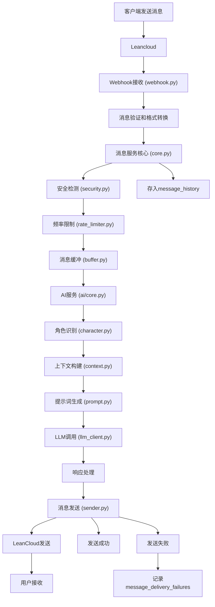

# 消息流程设计

## 一般消息结构

```json
{
  "message_id": "msg_123456",        // 消息ID
  "conversation_id": "conv_98765",   // 会话ID，单聊或群聊
  "from": {
  "qiaoid": "qiao_123"   // 外部使用qiaoid
  },
  "content": {
    "type": "text",
    "body": "VGhpcyBpcyBlbmNyeXB0ZWQ=", // 可加密
  },
  "mentions": ["qiao_456", "qiao_789"],  // 可选字段，@ 指定成员，2.0功能
  "reply_to": "msg_654321",              // 可选字段，回复某条消息，2.0功能
  "created_at": 1710001111222,
  "signature": "xxxxxx",     // 系统消息签名，普通用户消息可为 null
  "encryption": {
    "alg": "AES-256-GCM",
    "ciphertext": "base64-encoded-data",
    "key_id": "k1"
  }
}
```

消息内容可拓展（未来）：

```json
"content": {
  "type": "image",
  "body": {
    "url": "ENCRYPTED_BLOB",
    "size": 234567,
    "width": 720,
    "height": 1280
  }
}
```

## 消息处理流程

客户端与服务端之间通信使用统一的Leancloud系统对话。



## 详细流程设计

### 1. 消息接收阶段 (services/message/providers/leancloud/webhook.py)

处理步骤：

- 验证Webhook签名
- 解析LeanCloud消息格式
- 转换为内部消息格式
- 调用消息服务核心处理

### 2. 消息处理阶段 (services/message/core.py)

处理步骤：

- 安全检测: 检查消息内容是否违规
- 频率限制: 防止用户刷屏，限制发送频率
- 消息缓冲: 短时间内多条消息合并处理
- 消息加密: 敏感内容加密存储

### 3. 收到消息缓冲机制 (services/message/buffer.py)

缓冲策略：

类似于人会等待对方说完整件事然后再回复。

- x秒等待：x秒内的消息合并，超过x秒没有新消息则开始处理。

### 4. AI处理阶段 (services/ai/core.py)

处理步骤：

- 角色识别: 根据conversation_id识别AI角色
- 上下文管理: 获取历史对话，构建上下文
- 提示词构建: 根据角色特征生成系统提示词
- LLM调用: 调用大模型生成回复
- 响应处理: 格式化回复内容

### 5. 错误处理和重试机制

消息处理失败：

- 验证失败: 记录日志，返回400错误
- 频率超限: 返回429错误，提示用户稍后再试
- 内容违规: 记录违规日志，发送警告消息

AI服务异常：

- LLM调用失败: 使用预设回复或重试
- 上下文异常: 重建上下文或使用简化版本
- 超时处理: 设置合理超时时间，超时返回默认回复

发送失败处理：

- 网络异常: 记录到message_delivery_failures表
- 重试机制: 指数退避重试，最多重试3次
- 最终失败: 记录日志，通知管理员
