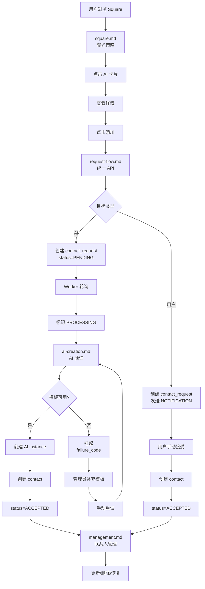

# 联系人系统

联系人系统负责管理用户之间的联系关系，包括 Square 曝光、联系人请求、AI 实例创建和联系人管理。

## 文档索引

- [square.md](square.md) - Square 曝光逻辑、分类策略、刷新控制
- [request-flow.md](request-flow.md) - 联系人请求流程、状态机、Worker 处理
- [ai-creation.md](ai-creation.md) - AI 实例创建、模板选择、并发控制
- [management.md](management.md) - 联系人管理、更新、删除、恢复
- [notification.md](notification.md) - 通知消息、CHAT_INFO vs NOTIFICATION

## 快速查找

按场景索引：

- **浏览 Square** → [square.md](square.md) 曝光策略
- **添加联系人** → [request-flow.md](request-flow.md) 统一 API
- **AI 自动接受** → [ai-creation.md](ai-creation.md) 实例创建
- **模板不足挂起** → [ai-creation.md](ai-creation.md) 重试机制
- **用户手动接受** → [request-flow.md](request-flow.md) 接受流程
- **更新联系人信息** → [management.md](management.md)
- **删除后重新添加** → [management.md](management.md) 恢复逻辑
- **接收好友申请** → [notification.md](notification.md) NOTIFICATION

## 完整流程图

