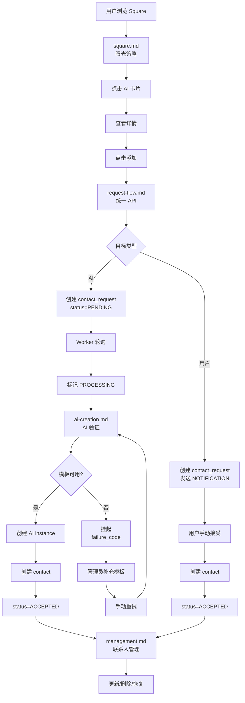

# 联系人系统

联系人系统负责管理用户之间的联系关系，包括 Square 曝光、联系人请求、AI 实例创建和联系人管理。

## 文档索引

- [square.md](square.md) - Square 曝光逻辑、分类策略、刷新控制
- [request-flow.md](request-flow.md) - 联系人请求流程、状态机、Worker 处理
- [ai-creation.md](ai-creation.md) - AI 实例创建、模板选择、并发控制
- [management.md](management.md) - 联系人管理、更新、删除、恢复
- [notification.md](notification.md) - 通知消息、CHAT_INFO vs NOTIFICATION

## 快速查找

按场景索引：

- **浏览 Square** → [square.md](square.md) 曝光策略
- **添加联系人** → [request-flow.md](request-flow.md) 统一 API
- **AI 自动接受** → [ai-creation.md](ai-creation.md) 实例创建
- **模板不足挂起** → [ai-creation.md](ai-creation.md) 重试机制
- **用户手动接受** → [request-flow.md](request-flow.md) 接受流程
- **更新联系人信息** → [management.md](management.md)
- **删除后重新添加** → [management.md](management.md) 恢复逻辑
- **接收好友申请** → [notification.md](notification.md) NOTIFICATION

## 核心概念

### 联系人类型

- USER (1) - 普通用户
- AI (2) - AI 联系人
- OFFICIAL (3) - 官方账号

### 请求状态

- PENDING (1) - 待处理
- ACCEPTED (2) - 已接受
- IGNORED (3) - 已忽略
- PROCESSING (8) - 处理中（仅 AI 请求）
- FAILED (9) - 失败（系统错误）

### Square 与联系人的关系

- **Square 曝光**：决定哪些 AI 类型在发现页展示
- **联系人请求**：用户点击添加后的处理流程
- **AI 创建**：AI 请求被接受后创建实例的逻辑
- **两者隔离**：Square 曝光不受模板库存影响

## 数据存储

- contacts - 联系人关系表 ([data-dict/contact.md](../../data-dict/contact.md))
- contact_requests - 联系人请求表 ([data-dict/contact.md](../../data-dict/contact.md))
- square_type_entries - Square 曝光配置 ([data-dict/discovery.md](../../data-dict/discovery.md))
- ai_personas - AI 角色定义 ([data-dict/ai-instantiation.md](../../data-dict/ai-instantiation.md))
- ai_templates - AI 模板库 ([data-dict/ai-instantiation.md](../../data-dict/ai-instantiation.md))
- ai_instances - AI 实例 ([data-dict/ai-instantiation.md](../../data-dict/ai-instantiation.md))

## API 接口

- GET /api/v1/discovery/square - 获取 Square 推荐 ([api/discovery.md](../../api/discovery.md))
- GET /api/v1/discovery/profile/{qiao_id} - 获取陌生人详情 ([api/discovery.md](../../api/discovery.md))
- POST /api/v1/contact-requests - 发送联系人请求 ([api/contact-requests.md](../../api/contact-requests.md))
- POST /api/v1/contact-requests/{id}/accept - 接受请求 ([api/contact-requests.md](../../api/contact-requests.md))
- POST /api/v1/contact-requests/{id}/ignore - 忽略请求 ([api/contact-requests.md](../../api/contact-requests.md))
- GET /api/v1/contacts - 获取联系人列表 ([api/contacts.md](../../api/contacts.md))
- PUT /api/v1/contacts/{conv_id} - 更新联系人 ([api/contacts.md](../../api/contacts.md))
- DELETE /api/v1/contacts/{conv_id} - 删除联系人 ([api/contacts.md](../../api/contacts.md))

## 完整流程图

## 设计原则

### 统一 API 设计

用户无需区分添加 AI 还是普通用户，使用同一个 API。后端根据 qiao_id 自动判断类型并路由到相应处理逻辑。

### Square 与模板隔离

Square 曝光只依赖 square_type_entries 表，不受模板库存影响。模板不足时请求会挂起，但不影响 Square 展示。

### 异步处理机制

AI 请求采用 Worker 轮询处理，避免阻塞用户请求。使用 PROCESSING 状态防止重复处理。

### 防重复请求

相同的 (from_qiao_id, to_qiao_id) 在有效期内只能有一条 PENDING 请求。重复提交会触发重试而不是创建新记录。

### 联系人恢复

删除联系人后再次添加会恢复关系，保留 conv_id 但更新 alias 和 tags。
