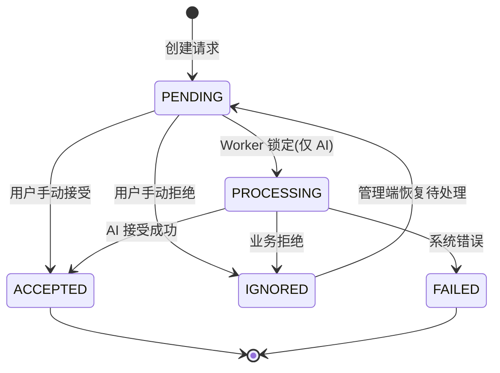

# 联系人请求流程

联系人请求系统负责处理用户添加联系人的申请，包括 AI 联系人和普通用户联系人。

## 核心设计原则

### API 设计

- 单一接口：`POST /api/v1/contact-requests`
- 后端自动判断目标类型（先查 users 表，再查 ai_personas 表）
- 统一返回格式：`{"message": "请求已发送"}`
- 前端无需关心内部处理细节

### 联系人请求 vs 联系人

**重要区别**：

- **联系人请求**（contact_requests 表）：申请记录，状态可能是待处理/已接受/已拒绝等
- **联系人**（contacts 表）：实际的联系人关系，只有在请求被接受后才创建

**关系**：

- 发送请求 → 创建 contact_request 记录
- 接受请求 → 创建 contact 记录
- 删除联系人 → 设置 contact.is_deleted=1（软删除）
- 重新添加 → 恢复 contact.is_deleted=0

### 防重复请求

相同请求在有效期内只能有一条：

- 检查条件：`(from_qiao_id, to_qiao_id, status=PENDING, expires_at > NOW())`
- 如果存在有效请求，直接返回成功（幂等）
- 如果请求已过期或已处理，可以创建新请求

## 请求状态机

### 状态定义

涉及数据表：`contact_requests`, `contacts`

- **PENDING (1)** - 待处理
  - 初始状态
  - AI 请求：等待 Worker 处理
  - 用户请求：等待目标用户手动接受/拒绝

- **PROCESSING (8)** - 处理中
  - 仅 AI 请求使用
  - Worker 锁定后立即标记
  - 防止重复处理

- **ACCEPTED (2)** - 已接受
  - 终态
  - 对应的 contact 记录已创建

- **IGNORED (3)** - 已忽略
  - 可由管理端恢复为待处理
  - 业务逻辑正常拒绝（非系统错误）
  - 例如：用户主动拒绝、AI 联系人数量达到上限

- **FAILED (9)** - 失败
  - 终态
  - 系统错误导致处理失败
  - 需要监控和告警

### 状态转换

## AI 联系人请求流程

### 1. 发送请求

**用户操作**：调用 `POST /api/v1/contact-requests`

**后端处理**：

前置步骤（客户端）：

- 若用户输入的是 AI username，先调用 `GET /api/v1/discovery/ai/search`
- 根据返回结果拿到 `qiao_id`
- 再发起 `POST /api/v1/contact-requests`

1. **联系人模块验证**：
   - 检查是否已添加该联系人（包括已删除的）
   - 如果已删除，恢复联系人关系并返回成功（见 [management.md](management.md)）
   - 如果已添加且未删除，返回错误
   - 检查是否有 PENDING 状态的有效请求，如有则直接返回成功（幂等）

2. **判断目标类型**：
   - 先查 users 表（通过 qiao_id）
   - 如果不存在，再查 ai_personas 表
   - 确定为 AI 类型

3. **验证 AI 联系人数量**：
   - 检查用户当前 AI 联系人数量
   - 如果达到上限，返回错误

4. **创建联系人请求记录**：
   - 创建 contact_request 记录
   - status = PENDING
   - to_type = AI
   - expires_at = NOW() + 7天

5. **返回统一响应**：
   - `{"message": "请求已发送"}`

### 2. Worker 异步处理

详见：`backend/app/services/contact/request_worker.py`

**轮询机制**：

1. **查询待处理请求**（每 2 秒）：
   - 条件：`status=PENDING AND to_type=AI AND expires_at > NOW()`
   - 使用 `FOR UPDATE SKIP LOCKED` 防止并发冲突
   - 每次最多处理 10 条

2. **立即标记 PROCESSING**：
   - 遍历批次中的每个请求
   - 更新 status = PROCESSING
   - 立即 commit，释放数据库锁

3. **独立处理每个请求**：
   - 为每个请求创建独立的 session
   - 调用 AI 创建逻辑（见 [ai-creation.md](ai-creation.md)）
   - 处理失败不影响其他请求

4. **更新最终状态**：
   - 成功 → ACCEPTED
   - 业务拒绝 → IGNORED
   - 系统错误 → FAILED

### 3. 过期请求处理

**策略**：查询时过滤，不主动标记

**原因**：

- 符合 YAGNI 原则，不需要额外的定时任务
- 节省系统资源
- 通过 `expires_at > NOW()` 过滤即可

**过期请求状态**：

- 保持 PENDING 状态
- 不会被 Worker 处理
- 可以通过查询识别：`status=PENDING AND expires_at < NOW()`

## 用户联系人请求流程

### 1. 发送请求

**用户操作**：调用 `POST /api/v1/contact-requests`

**后端处理**：

1. **联系人模块验证**（同 AI 流程）

2. **判断目标类型**：
   - 查询 users 表
   - 确定为 USER 类型

3. **创建联系人请求记录**：
   - 创建 contact_request 记录
   - status = PENDING
   - to_type = USER

4. **发送 NOTIFICATION 消息**：
   - 调用通知发送服务
   - 发送联系人请求通知给目标用户
   - 详见：[notification.md](notification.md)

5. **返回统一响应**：
   - `{"message": "请求已发送"}`

### 2. 目标用户接受

**用户操作**：调用 `POST /api/v1/contact-requests/{request_id}/accept`

**后端处理**：

1. **验证请求**：
   - 获取 contact_request 记录
   - 验证请求是否存在
   - 验证当前用户是否有权操作（to_qiao_id 必须是当前用户）
   - 验证请求状态是否为 PENDING

2. **创建联系人记录**：
   - 创建 contact 记录
   - contact_type = USER
   - contact_qiao_id = 申请人的 qiao_id
   - 设置 alias、tags 等信息

3. **更新请求状态**：
   - status = ACCEPTED
   - 提交事务

4. **发送 CHAT_INFO 消息**：
   - 发送消息到申请人的对话
   - 内容："对方已将你添加为联系人"
   - 详见：[notification.md](notification.md)

5. **返回 ContactResponse**：
   - 返回完整的联系人信息

### 3. 目标用户拒绝

**用户操作**：调用 `POST /api/v1/contact-requests/{request_id}/ignore`

**后端处理**：

1. **验证请求**（同接受流程）

2. **更新请求状态**：
   - status = IGNORED
   - 提交事务

3. **不发送通知**：
   - 保护隐私，不让申请人知道被拒绝

4. **返回成功响应**：
   - `{"message": "已忽略"}`

## 模板不可用与重试流程

当 AI 请求在当前选择规则下无法选中模板时，请求不会被拒绝，而是保持在 PENDING 状态并记录失败原因。

详见：[ai-creation.md](ai-creation.md) 的"模板不足挂起机制"

**重试逻辑**：

- 管理员可在后台触发自动重试或指定模板重试
- 指定模板重试支持预检结果展示，预检仅作为即时参考
- 手动重试在未指定模板时要求选择 `AI Type`；指定模板时 `AI Type` 可选
- 手动重试在传入模板时强制使用指定模板执行，不保证最终成功
- 手动重试弹窗的模板详情中，`Style` 与 `Personality` 展示名称字段；名称缺失时回退展示对应 ID
- 管理员确认执行后直接进入重试流程，以实时重试结果为准
- 用户重复提交命中未完成请求（`PENDING` 或 `PROCESSING`）时，系统直接返回成功，不变更原请求状态
- 请求已过期或进入终态时，重复提交会创建新请求并重新进入处理流程

## 联系人恢复逻辑

详见：[management.md](management.md) 的"删除和恢复"

## 异常处理

### 验证失败

**原则**：前端应做前置验证，后端验证失败时不返回详细错误信息

**处理方式**：

- 返回通用错误信息
- 不暴露内部细节
- 记录详细日志用于调试

### AI 验证失败

**处理**：

- 标记为 IGNORED（业务拒绝）或 FAILED（系统错误）
- 记录错误日志
- 不暴露内部细节给用户

### 通知发送失败

**处理**：

- 非关键操作，记录日志但不中断流程
- 请求状态仍然更新为 ACCEPTED
- 记录 warning 日志

## API 接口

详见：[api/contact-requests.md](../../api/contact-requests.md)

- POST /api/v1/contact-requests - 发送联系人请求
- POST /api/v1/contact-requests/{request_id}/accept - 接受请求
- POST /api/v1/contact-requests/{request_id}/ignore - 忽略请求
- 管理端接口详见：[api/admin-contact-requests.md](../../api/admin-contact-requests.md)

### 管理后台重试 API

- 路径：
  - `GET /admin-api/contact-requests/incomplete/overview`
  - `GET /admin-api/contact-requests/incomplete`
  - `POST /admin-api/contact-requests/{request_id}/ignore`
  - `POST /admin-api/contact-requests/{request_id}/reopen-pending`
  - `GET /admin-api/contact-requests/ai-types/search`
  - `GET /admin-api/contact-requests/templates/search`
  - `POST /admin-api/contact-requests/{request_id}/retry-precheck`
  - `POST /admin-api/contact-requests/{request_id}/retry`
- 鉴权：复用 Starlette Admin Session。
- 权限：
  - 自动重试：登录后台账号可执行。
  - 指定模板重试：仅 `SUPER_ADMIN` 可执行。
- 预检语义：
  - 返回阻断项（`blocking_errors`）、告警项（`warnings`）、检查项（`checks`）与汇总（`summary`）。
  - 阻断项表示不可执行；告警项表示可在确认后执行。
- 执行语义：
  1. `mode` 使用字符串枚举 `ContactRequestRetryMode`，仅允许 `AUTO`、`MANUAL`。
  2. `FOR UPDATE` 锁定目标请求并校验重试资格。
  3. 重试前后使用同一规则分级模型校验（阻断/告警）。
  4. 命中阻断项时直接失败并返回 `409 Conflict`。
  5. `mode=MANUAL` 且未传 `selected_template_id` 时，必须传入 `selected_ai_type_id`。
  6. `mode=MANUAL` 且传入 `selected_template_id` 时，`selected_ai_type_id` 可选。
  7. `mode=MANUAL` 且未传 `selected_template_id` 时，系统按 `selected_ai_type_id` 自动选模板执行，仍可能失败。
  8. `mode=MANUAL` 且传入 `selected_template_id` 时，系统强制使用指定模板执行。
  9. `mode=MANUAL` 且同时传入 `selected_template_id + selected_ai_type_id` 且两者类型不一致时：
     - 预检返回高风险告警。
     - 执行阶段允许继续，要求 `SUPER_ADMIN` 且 `force_continue=true`。
  10. `mode=MANUAL` 且所选模板已被该用户使用过时：
      - 预检返回阻断项 `TEMPLATE_ALREADY_USED_BY_USER`。
      - 执行阶段强制拦截并返回 `409`。
  11. 当请求原始 AI 类型不可解析时：
      - 未传 `selected_template_id`：执行失败。
      - 传入 `selected_template_id`：允许执行；实例对外 `ai_type` 为空，并在 `creation_metadata` 记录原因说明。
  12. 创建成功后更新请求状态为 `ACCEPTED`；失败保持未完成状态并写回失败信息；系统异常记录失败状态。
  13. 写入管理员操作审计与重试尝试事件。

### 管理后台未完成请求面板

未完成请求面板入口路径为 `/qiao-dash/incomplete-contact-requests`。

1. **工作台布局**
   - 筛选区、列表区位于同一工作台卡片。
2. **概览区**
   - 未完成总数（`incomplete_total`）。
   - 24h 重试成功请求数（按请求去重）。
   - 24h 重试失败请求数（按请求去重）。
   - 24h 重试失败次数（按尝试事件计数）。
   - 24h 重试阻断次数（按 `result_status=REJECTED` 计数，排除业务拒绝码 `AI_CONTACT_LIMIT_REACHED` 与 `RETRY_REJECTED`）。
3. **未完成列表**
   - 展示未成功且未完成的请求：`PENDING`、`PROCESSING`、`FAILED`。
   - 不展示 `IGNORED` 与 `ACCEPTED`。
   - 列表支持分页查询。
4. **列表字段**
   - 请求字段：`status`、`申请时间`（按 `created_at` 计算相对当前时间，示例 `1天23小时前`）。
   - 到期字段：`到期时间`（按 `expires_at` 计算相对当前时间）与 `是否有效`（由 `is_expired` 映射图标：有效/无效）。
   - 参与方字段：`from_qiao_id`、`to_qiao_id`、`from_id`、`to_id`。
   - 失败字段：`failure_reason_label`、`ai_type_display_name`。
   - 重试字段：`retry_count`、`last_retry_at`、`is_retryable`。
   - 时间字段按浏览器时区展示，UTC 原值用于排障提示。
5. **操作行为**
   - 查看：直接跳转 `/qiao-dash/contact_request/detail/{request_id}`。
   - 补模板：跳转 `ai_template` 列表并通过 `search` 参数过滤。
   - 忽略：二次确认后将状态改为 `IGNORED`，并从未完成列表移除。
   - 恢复待处理：在 `contact_request` 页面仅对 `IGNORED` 请求开放，执行后状态改为 `PENDING`。
   - 重试：仅 `is_retryable=true` 的记录可执行。
   - 指定模板重试：打开“手动指定重试”弹窗，进入后默认选中原始请求 `AI Type`，并自动加载该类型模板列表。
   - 指定模板重试：模板检索始终按所选 `AI Type` 过滤。
   - 指定模板重试：模板选项显示 `ID + 名称 + 状态 + 优先级`，示例：`[12] Friendly Default Config (ACTIVE, P=1)`。
   - 指定模板重试：选择模板后自动预检；第一步“继续”，第二步“后退/确认”。
   - 指定模板重试：当所选 `AI Type` 与原始请求 `AI Type` 不一致时，在弹窗内显示告警提示。
   - 指定模板重试：当所选模板已被该用户使用过时，预检显示阻断提示并禁用确认执行。
   - 执行反馈：重试结果在弹窗内展示，成功后禁用执行按钮，弹窗不自动关闭，由管理员手动关闭。

### 管理端重试统计口径

- 请求维度：
  - `24h 重试失败请求数` 按 `request_id` 去重。
- 尝试维度：
  - `24h 重试失败次数` 按重试尝试事件计数。
- `24h 重试阻断次数` 按 `result_status=REJECTED` 计数，排除业务拒绝码 `AI_CONTACT_LIMIT_REACHED` 与 `RETRY_REJECTED`。
- 类型维度：
  - 需求侧归属：`requested_ai_type_id`。
  - 供给侧归属：`selected_template_type_id`。
