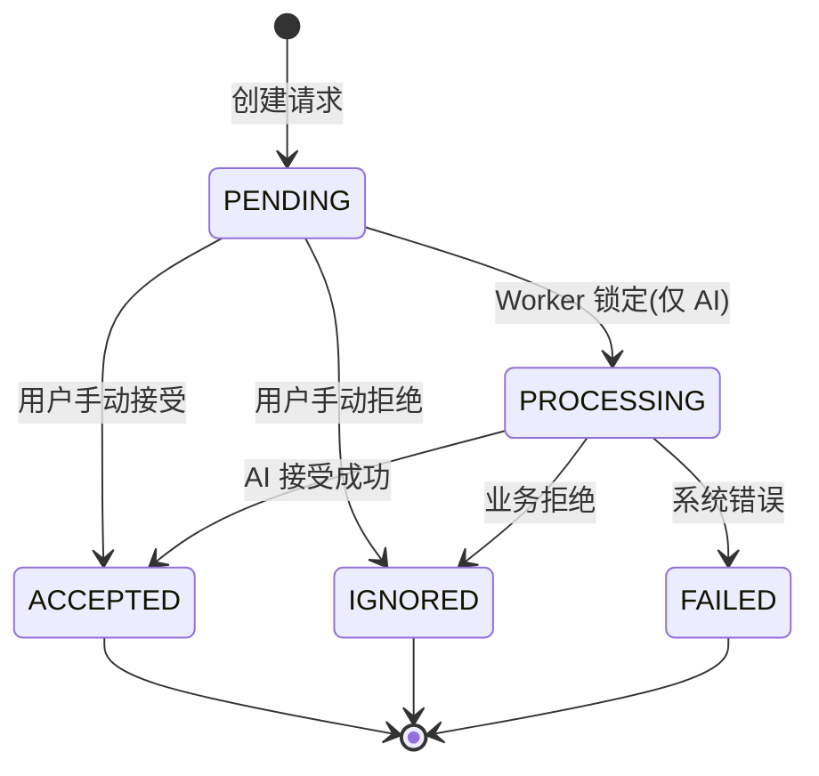

# 联系人请求流程

联系人请求系统负责处理用户添加联系人的申请，包括 AI 联系人和普通用户联系人。

## 核心设计原则

### API 设计

- 单一接口：`POST /api/v1/contact-requests`
- 后端自动判断目标类型（先查 users 表，再查 ai_personas 表）
- 统一返回格式：`{"message": "请求已发送"}`
- 前端无需关心内部处理细节

### 联系人请求 vs 联系人

**重要区别**：

- **联系人请求**（contact_requests 表）：申请记录，状态可能是待处理/已接受/已拒绝等
- **联系人**（contacts 表）：实际的联系人关系，只有在请求被接受后才创建

**关系**：

- 发送请求 → 创建 contact_request 记录
- 接受请求 → 创建 contact 记录
- 删除联系人 → 设置 contact.is_deleted=1（软删除）
- 重新添加 → 恢复 contact.is_deleted=0

### 防重复请求

相同请求在有效期内只能有一条：

- 检查条件：`(from_qiao_id, to_qiao_id, status=PENDING, expires_at > NOW())`
- 如果存在有效请求，直接返回成功（幂等）
- 如果请求已过期或已处理，可以创建新请求

## 请求状态机

### 状态定义

详见：[data-dict/contact.md](../../data-dict/contact.md)

- **PENDING (1)** - 待处理
  - 初始状态
  - AI 请求：等待 Worker 处理
  - 用户请求：等待目标用户手动接受/拒绝

- **PROCESSING (8)** - 处理中
  - 仅 AI 请求使用
  - Worker 锁定后立即标记
  - 防止重复处理

- **ACCEPTED (2)** - 已接受
  - 终态
  - 对应的 contact 记录已创建

- **IGNORED (3)** - 已忽略
  - 终态
  - 业务逻辑正常拒绝（非系统错误）
  - 例如：用户主动拒绝、AI 联系人数量达到上限

- **FAILED (9)** - 失败
  - 终态
  - 系统错误导致处理失败
  - 需要监控和告警

### 状态转换

## AI 联系人请求流程

### 1. 发送请求

**用户操作**：调用 `POST /api/v1/contact-requests`

**后端处理**：

前置步骤（客户端）：

- 若用户输入的是 AI username，先调用 `GET /api/v1/discovery/ai/search`
- 根据返回结果拿到 `qiao_id`
- 再发起 `POST /api/v1/contact-requests`

1. **联系人模块验证**：
   - 检查是否已添加该联系人（包括已删除的）
   - 如果已删除，恢复联系人关系并返回成功（见 [management.md](management.md)）
   - 如果已添加且未删除，返回错误
   - 检查是否有 PENDING 状态的有效请求，如有则直接返回成功（幂等）

2. **判断目标类型**：
   - 先查 users 表（通过 qiao_id）
   - 如果不存在，再查 ai_personas 表
   - 确定为 AI 类型

3. **验证 AI 联系人数量**：
   - 检查用户当前 AI 联系人数量
   - 如果达到上限，返回错误

4. **创建联系人请求记录**：
   - 创建 contact_request 记录
   - status = PENDING
   - to_type = AI
   - expires_at = NOW() + 7天

5. **返回统一响应**：
   - `{"message": "请求已发送"}`

### 2. Worker 异步处理

详见：`backend/app/services/contact/request_worker.py`

**轮询机制**：

1. **查询待处理请求**（每 2 秒）：
   - 条件：`status=PENDING AND to_type=AI AND expires_at > NOW()`
   - 使用 `FOR UPDATE SKIP LOCKED` 防止并发冲突
   - 每次最多处理 10 条

2. **立即标记 PROCESSING**：
   - 遍历批次中的每个请求
   - 更新 status = PROCESSING
   - 立即 commit，释放数据库锁

3. **独立处理每个请求**：
   - 为每个请求创建独立的 session
   - 调用 AI 创建逻辑（见 [ai-creation.md](ai-creation.md)）
   - 处理失败不影响其他请求

4. **更新最终状态**：
   - 成功 → ACCEPTED
   - 业务拒绝 → IGNORED
   - 系统错误 → FAILED

### 3. 过期请求处理

**策略**：查询时过滤，不主动标记

**原因**：

- 符合 YAGNI 原则，MVP 不需要额外的定时任务
- 节省系统资源
- 通过 `expires_at > NOW()` 过滤即可

**过期请求状态**：

- 保持 PENDING 状态
- 不会被 Worker 处理
- 可以通过查询识别：`status=PENDING AND expires_at < NOW()`

## 用户联系人请求流程

### 1. 发送请求

**用户操作**：调用 `POST /api/v1/contact-requests`

**后端处理**：

1. **联系人模块验证**（同 AI 流程）

2. **判断目标类型**：
   - 查询 users 表
   - 确定为 USER 类型

3. **创建联系人请求记录**：
   - 创建 contact_request 记录
   - status = PENDING
   - to_type = USER

4. **发送 NOTIFICATION 消息**：
   - 调用通知发送服务
   - 发送联系人请求通知给目标用户
   - 详见：[notification.md](notification.md)

5. **返回统一响应**：
   - `{"message": "请求已发送"}`

### 2. 目标用户接受

**用户操作**：调用 `POST /api/v1/contact-requests/{id}/accept`

**后端处理**：

1. **验证请求**：
   - 获取 contact_request 记录
   - 验证请求是否存在
   - 验证当前用户是否有权操作（to_qiao_id 必须是当前用户）
   - 验证请求状态是否为 PENDING

2. **创建联系人记录**：
   - 创建 contact 记录
   - contact_type = USER
   - contact_qiao_id = 申请人的 qiao_id
   - 设置 alias、tags 等信息

3. **更新请求状态**：
   - status = ACCEPTED
   - 提交事务

4. **发送 CHAT_INFO 消息**：
   - 发送消息到申请人的对话
   - 内容："对方已将你添加为联系人"
   - 详见：[notification.md](notification.md)

5. **返回 ContactResponse**：
   - 返回完整的联系人信息

### 3. 目标用户拒绝

**用户操作**：调用 `POST /api/v1/contact-requests/{id}/ignore`

**后端处理**：

1. **验证请求**（同接受流程）

2. **更新请求状态**：
   - status = IGNORED
   - 提交事务

3. **不发送通知**：
   - 保护隐私，不让申请人知道被拒绝

4. **返回成功响应**：
   - `{"message": "已忽略"}`

## 模板不足与重试流程

当 AI 类型暂时没有可用模板时，请求不会被拒绝，而是保持在 PENDING 状态并记录失败原因。

详见：[ai-creation.md](ai-creation.md) 的"模板不足挂起机制"

**重试逻辑**：

- 管理员补充模板后，可在后台触发重试
- 用户重复提交相同请求时，触发同一条记录的重试
- 重试会清空 failure_code/failure_detail，重新执行处理流程

## 联系人恢复逻辑

详见：[management.md](management.md) 的"删除和恢复"

**场景**：用户之前删除过联系人（is_deleted=1），现在想重新添加

**流程**：

1. 检查联系人关系（包括已删除的）
2. 如果 is_deleted=1，调用恢复逻辑
3. 恢复联系人关系，更新 alias 和 tags
4. 返回统一响应：`{"message": "请求已发送"}`

**保留内容**：

- conversation_id（对话 ID）

**不保留内容**：

- remark（备注信息）

**更新内容**：

- alias（备注名）
- tags（标签）

## 异常处理

### 验证失败

**原则**：前端应做前置验证，后端验证失败时不返回详细错误信息

**处理方式**：

- 返回通用错误信息
- 不暴露内部细节
- 记录详细日志用于调试

### AI 验证失败

**处理**：

- 标记为 IGNORED（业务拒绝）或 FAILED（系统错误）
- 记录错误日志
- 不暴露内部细节给用户

### 通知发送失败

**处理**：

- 非关键操作，记录日志但不中断流程
- 请求状态仍然更新为 ACCEPTED
- 记录 warning 日志

## 监控建议

### 关键指标

- PENDING 请求数量（按类型统计）
- PROCESSING 请求平均处理时间
- FAILED 请求数量（需要告警）
- 过期请求数量

### 告警规则

- 1 小时内 FAILED > 10（系统错误）
- PROCESSING 状态超过 5 分钟（Worker 可能崩溃）
- 过期 PENDING 请求 > 100（需要清理）

## API 接口

详见：[api/contact-requests.md](../../api/contact-requests.md)

- POST /api/v1/contact-requests - 发送联系人请求
- POST /api/v1/contact-requests/{id}/accept - 接受请求
- POST /api/v1/contact-requests/{id}/ignore - 忽略请求

### 管理后台重试 API

- 路径：`POST /api/v1/admin/contact-requests/{request_id}/retry`
- 鉴权：复用 Starlette Admin 的 Session（依赖 `verify_admin_session`），仅登录的后台管理账号可调用
- 行为：
  1. `FOR UPDATE` 锁定目标请求，校验 `status=PENDING`
  2. `retry_count += 1`，`last_retry_at = NOW()`，清空 `failure_*`
  3. 调用 `_process_ai_contact_request`，成功则状态变为 `ACCEPTED` 并创建联系人；失败则重新写入新的 `failure_code/detail`
- 日志：在挂起、清空、重试等动作上分别记录 `contact_request_pending`、`contact_request_retry` 等结构化日志字段（`request_id`、`ai_type_id`、`admin_user`、`retry_count` 等）

### 管理后台挂起处理面板

自定义视图 `custom_views/contact_request_pending.html`（Starlette Admin）提供流程化的操作面板：

1. **概览区**：展示挂起请求总数、按 `ai_type_id` 的 Top N、24 小时内重试成功/失败数量，数据来自 `contact_requests` 聚合。
2. **挂起列表**：
   - 字段：`request_id`、`from_qiao_id`、`to_qiao_id`、`ai_type_id`（来源于 `failure_detail.ai_type_id`）、`failure_code`、`retry_count`、`last_retry_at`、`updated_at`
   - 过滤器：支持按 `ai_type_id`、`failure_code`、更新时间筛选
   - 操作列提供：
     - “补模板”跳转：根据 `ai_type_id` 进入模板管理页面
     - “立即重试”按钮：调用上述 Admin API，返回后刷新行状态
3. **详情侧栏**：点击任一行展开，展示原始请求信息、`failure_detail` JSON、最近日志记录，并以“查看缺模板 → 补模板 → 重试”步骤条提示管理员完成流程。

若重试失败，行会重新回到列表顶部并显示新的 `failure_code` 与时间戳；成功后记录从列表移除，由后台 Worker 继续后续流程。
