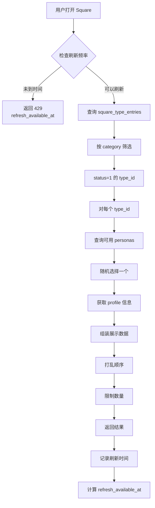

# Square 曝光逻辑

Square（发现页）负责向用户展示可添加的 AI 联系人，采用随机推荐策略。

## 核心设计原则

### Square 与模板库存隔离

- Square 曝光**仅依赖** `square_type_entries` 表
- 模板库存状态**不影响** Square 展示
- 用户看到的 AI 可能暂时无法创建（模板不足时会挂起请求）
- 这种设计避免了 Square 频繁变化，提供稳定的用户体验

### Persona 复用机制

- Square 展示的是 `ai_personas`（角色定义），不是 `ai_instances`（实例）
- 每个 persona 有唯一的 `qiao_id`
- 多个用户可以添加同一个 `qiao_id`，后端根据模板创建不同的 instance
- Profile 信息来自 `profiles` 表（owner_type=2, owner_id=persona.id）

## 数据流程

### 1. Square 配置

管理员在后台配置哪些 AI 类型在 Square 曝光：

- 表：`square_type_entries`
- 字段：
  - `square_category` - 分类（交友、恋爱、倾诉等）
  - `type_id` - 关联 `ai_types.id`
  - `exposure_strategy` - 曝光策略（随机、权重等）
  - `status` - 是否启用（inactive 时不展示）

详见：[data-dict/discovery.md](../../data-dict/discovery.md)

### 2. Persona 选择

接口根据 `type_id` 实时选择可用的 persona：

**选择条件**：

- `ai_personas.type_id` 匹配
- `ai_personas.status = 1`（可用）
- 如果 `is_reusable = 0`（不可复用），则 `status != 3`（未被使用）

**选择策略**：

- 根据 `exposure_strategy` 决定选择逻辑
- 默认策略：随机选择
- 未来可扩展：权重、优先级等

### 3. 展示信息

前端展示的信息来自 `profiles` 表：

- `qiao_id` - 来自 `ai_personas.qiao_id`
- `username` - 来自 `ai_personas.username`（AI 搜索标识）
- `nickname` - 来自 `profiles.nickname`
- `avatar_url` - 由 `profiles.avatar_file_id` -> `media_files` -> CDN 动态生成
- `gender` - 来自 `profiles.gender`
- `bio` - 来自 `profiles.bio`
- `region` - 来自 `profiles.region`
- `category` - 来自 `square_type_entries.square_category`

## 刷新控制

### 频率限制

防止用户频繁刷新，保护服务器资源：

**配置项**（system_configs 表）：

- `square_refresh_interval` - 刷新间隔（秒），默认 60
- `square_recommend_count` - 每次推荐数量，默认 10

**实现逻辑**：

- 记录用户上次刷新时间
- 计算下次可刷新时间：`last_refresh_at + interval`
- 返回 `refresh_available_at` 给前端
- 前端根据此时间禁用刷新按钮

**测试模式**：

- `force_refresh=true` 可跳过频率限制
- 仅用于开发测试，生产环境应禁用

### 推荐算法

当前采用**简单随机**策略：

1. 查询指定 category 下所有启用的 `square_type_entries`
2. 对每个 `type_id` 随机选择一个可用 persona
3. 打乱顺序后返回指定数量
4. 每次刷新结果不同

**未来扩展**：

- 基于用户画像的个性化推荐
- 基于权重的加权随机
- 新 AI 优先曝光
- 冷启动策略

## 业务流程

## 与联系人请求的关系

Square 只负责**展示**，不负责**添加**：

1. 用户在 Square 看到 AI 卡片
2. 点击查看详情（调用 `/api/v1/discovery/profile/{qiao_id}`）
3. 点击添加（调用 `/api/v1/contact-requests`）
4. 后续流程见 [request-flow.md](request-flow.md)

**关键点**：

- Square 展示的 `qiao_id` 是 persona 的 ID
- Square 可展示 `username`，但添加时仍以 `qiao_id` 发起请求
- 添加时使用这个 `qiao_id` 发起请求
- 后端根据 `qiao_id` 查找 persona 和模板
- 创建的 instance 继承 persona 的 `qiao_id`

## 异常处理

### Persona 不可用

如果某个 `type_id` 下没有可用 persona：

- 跳过该 type_id
- 不影响其他 type_id 的展示
- 记录 warning 日志

### 所有 Persona 不可用

如果某个 category 下所有 type_id 都没有可用 persona：

- 返回空列表
- 前端显示"暂无推荐"
- 记录 error 日志，需要管理员介入

### 刷新频率超限

- 返回 HTTP 429 Too Many Requests
- 响应体包含 `refresh_available_at`
- 前端根据此时间显示倒计时

## API 接口

详见：[api/discovery.md](../../api/discovery.md)

- GET /api/v1/discovery/square - 获取 Square 推荐
- GET /api/v1/discovery/profile/{qiao_id} - 获取陌生人详情
