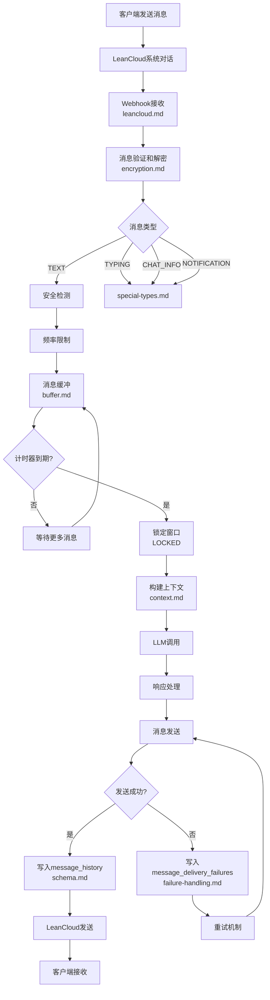

# 消息系统

消息系统负责处理客户端与服务端之间的所有消息通信，包括用户消息、AI响应、输入状态、系统通知等。

## 文档索引

- [schema.md](schema.md) - 消息数据结构、ID规则、Event定义
- [buffer.md](buffer.md) - AI消息缓冲、双计时器、唤醒机制
- [context.md](context.md) - 上下文管理、消息查询、裁剪策略
- [leancloud.md](leancloud.md) - LeanCloud集成、Webhook处理
- [delivery-reliability.md](delivery-reliability.md) - 离线消息与未来消息同步
- [encryption.md](encryption.md) - 消息加密、Base64/AES方案
- [special-types.md](special-types.md) - TYPING/CHAT_INFO/NOTIFICATION处理
- [failure-handling.md](failure-handling.md) - 失败处理、重试机制

## 快速查找

按场景索引：

- **用户发送消息** → [leancloud.md](leancloud.md) Webhook → [buffer.md](buffer.md) 缓冲
- **AI生成回复** → [context.md](context.md) 构建上下文 → [buffer.md](buffer.md) 触发处理
- **消息发送失败** → [failure-handling.md](failure-handling.md)
- **输入状态显示** → [special-types.md](special-types.md) TYPING
- **系统通知** → [special-types.md](special-types.md) NOTIFICATION
- **消息加密** → [encryption.md](encryption.md)
- **消息ID规则** → [schema.md](schema.md)

## 完整消息流

