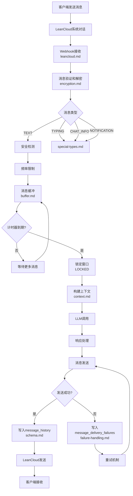

# 消息系统

消息系统负责处理客户端与服务端之间的所有消息通信，包括用户消息、AI响应、输入状态、系统通知等。

## 文档索引

- [schema.md](schema.md) - 消息数据结构、ID规则、Event定义
- [buffer.md](buffer.md) - AI消息缓冲、双计时器、唤醒机制
- [context.md](context.md) - 上下文管理、消息查询、裁剪策略
- [leancloud.md](leancloud.md) - LeanCloud集成、Webhook处理
- [encryption.md](encryption.md) - 消息加密、Base64/AES方案
- [special-types.md](special-types.md) - TYPING/CHAT_INFO/NOTIFICATION处理
- [failure-handling.md](failure-handling.md) - 失败处理、重试机制

## 快速查找

按场景索引：

- **用户发送消息** → [leancloud.md](leancloud.md) Webhook → [buffer.md](buffer.md) 缓冲
- **AI生成回复** → [context.md](context.md) 构建上下文 → [buffer.md](buffer.md) 触发处理
- **消息发送失败** → [failure-handling.md](failure-handling.md)
- **输入状态显示** → [special-types.md](special-types.md) TYPING
- **系统通知** → [special-types.md](special-types.md) NOTIFICATION
- **消息加密** → [encryption.md](encryption.md)
- **消息ID规则** → [schema.md](schema.md)

## 完整消息流

## 核心概念

### 消息方向

- **Inbound**: 客户端 → 服务端（用户发送）
- **Outbound**: 服务端 → 客户端（AI/系统发送）

### 消息类型

- TEXT (1) - 文本消息
- TYPING_START (2) - 开始输入
- TYPING_END (3) - 结束输入
- CHAT_INFO (4) - 对话提示信息
- NOTIFICATION (9) - 系统通知

### 消息ID

- `msg_id_client`: 客户端生成（格式：`client_{timestamp}_{random}`）
- `msg_id_server`: 服务端生成（Snowflake ID）
- `msg_id_provider_inbound`: LeanCloud入站ID
- `msg_id_provider_outbound`: LeanCloud出站ID

详见 [schema.md](schema.md)

## 数据存储

- message_history - 消息历史记录 ([data-dict/message.md](../../data-dict/message.md))
- message_delivery_failures - 发送失败记录 ([data-dict/message.md](../../data-dict/message.md))
- ai_message_buffer - AI消息缓冲状态 ([data-dict/ai-message-buffer.md](../../data-dict/ai-message-buffer.md))
- ai_conversation_items - AI对话历史 ([data-dict/ai-conversation.md](../../data-dict/ai-conversation.md))

## API接口

- GET /api/v1/lc-im/config - 获取消息服务配置 ([api/leancloud-message.md](../../api/leancloud-message.md))
- POST /api/v1/lc-im/signature - 获取客户端签名 ([api/leancloud-message.md](../../api/leancloud-message.md))
- POST /api/v1/lc-im/webhook/{token} - LeanCloud消息回调 ([api/leancloud-message.md](../../api/leancloud-message.md))

## 关键配置

从 system_configs 表获取：

- message_buffer_normal_wait_ms: 3000 - 普通消息等待时间（毫秒）
- message_buffer_no_typing_wait_ms: 8000 - 无输入状态等待时间
- message_buffer_typing_end_wait_ms: 3000 - 输入结束等待时间
- message_buffer_typing_total_wait_ms: 32000 - 宏计时器上限

详见 [buffer.md](buffer.md)
